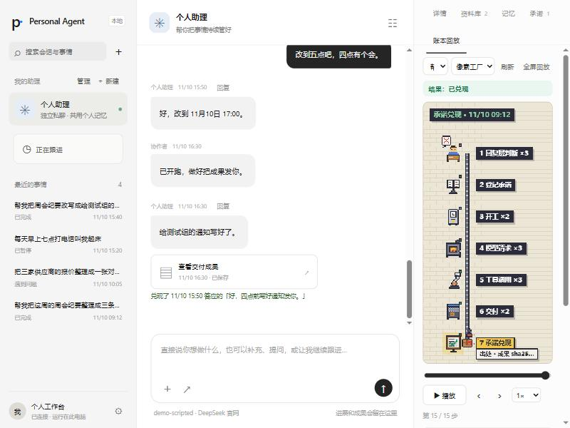
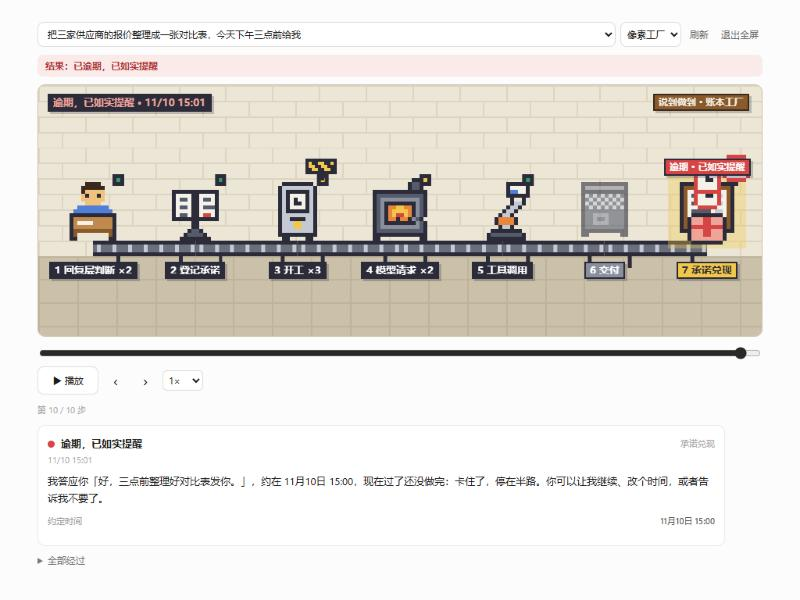
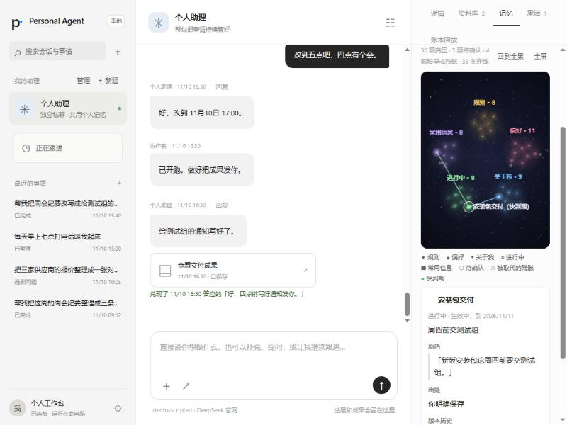
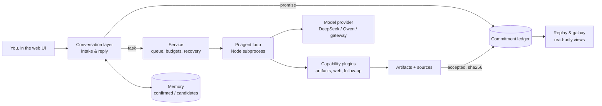

# Noyi

**A personal AI agent that keeps its word.** Every "I'll do it" is logged as a promise, every result cites where it came from, and anything the agent only *inferred* about you waits for your confirmation.

English · [简体中文](README.zh-CN.md)

**Live demo (read-only, no sign-up): <https://baobao1996121.github.io/noyi/>**

The name comes from 一诺 (*yī nuò*, "a promise kept"), read backwards.



## Why

Chat assistants are good at saying "sure, I'll remind you" and bad at proving they did. Noyi is a learning project built around one idea: **an agent should be held to what it says**.

- A promise is a database row, not a sentence. It is bound to the task or schedule that will fulfil it.
- "Done" comes with evidence: the artifact, its sha256, and the sources that were actually read.
- If it cannot do something, it says so and the promise closes as *unable*. If a deadline passes, you are told once.
- Memories it guessed from conversation are only *candidates* until you accept them.

## Features

**Commitment ledger.** Each promise made in a reply is registered and linked to the work that owns it. Promises with a stated deadline are reminded once when overdue; promises stuck for more than a day are reminded once. Only you can reschedule. A reply that promises something without registering it is blocked: the agent must either register the promise or rephrase.

**Fulfilment with sources.** A task is accepted only after checks on the artifact, on read coverage of the authorized sources, and on citations. A kept promise links to the exact artifact version and hash.

**Memory with a candidate area and a daily review sheet.** Five kinds of memory (rules, preferences, about me, ongoing, reference). Things you state explicitly are saved. Things the agent infers go to a candidate area with the original quotes as evidence. A daily review sheet only *proposes* merges and cleanups; nothing changes until you confirm. Newer memories can supersede older ones, and conflicts ask you to pick one.

**Ledger replay.** Pick a task and replay its path through seven stations: intake decision, promise registered, work started, model requests, tool calls, delivery, promise kept. Overdue, unable, rescheduled, dropped, and blocked promises show as branches. You can play, pause, scrub, step, change speed, and go fullscreen. There are two skins, geometric and pixel factory, and both are drawn entirely in code.

**Memory galaxy.** A read-only star map of your memories. Confirmed memories are bright stars, pending ones are dashed, and superseded ones are wrecks linked to whatever replaced them. Ongoing items that expire within 7 days blink. Click a star to see its quote, source, and version history.

| Overdue promise in the replay | Memory galaxy |
|---|---|
|  |  |

All screenshots come from the scripted demo database (`scripts/demo-replay.py`), not from real use.

## Quick start

Requirements: Python 3.11+, Node.js 22.19+. The install script below targets Windows, the platform this project has been tested on. On other systems, follow the manual steps.

```powershell
git clone https://github.com/BaoBao1996121/noyi.git
cd noyi
.\Install.cmd
.\noyi.cmd start
```

`noyi start` opens `http://127.0.0.1:8765`. Use `noyi stop`, `noyi restart`, and `noyi status` to manage the background service. Data stays in `.pa/personal` inside the repository folder, which is ignored by Git.

Manual install (any OS, untested outside Windows):

```bash
python -m venv .venv
.venv/bin/python -m pip install -r requirements-lock.txt
.venv/bin/python -m pip install --no-deps -e .
npm ci --prefix ./src/personal_agent/pi_bridge --ignore-scripts
.venv/bin/python -m personal_agent --data .pa/personal web --port 8765
```

### Try the demo without an API key

The demo database is built by the real pipeline using a scripted model. No model API is called.

```powershell
.\.venv\Scripts\python.exe scripts\demo-replay.py build --data .pa\demo-replay
.\.venv\Scripts\python.exe scripts\demo-replay.py serve --data .pa\demo-replay
```

Then open `http://127.0.0.1:8790`, choose a task, and open the **账本回放** (ledger replay) tab or the **记忆** (memory) tab. The UI text is currently in Chinese.

## Model configuration

Open the settings (bottom-left gear) and enter a model name, an endpoint, and an API key. The key is stored only in your local data folder and is never echoed back. To keep the key out of the data folder, put it in an environment variable and tell Noyi its name with `PA_API_KEY_ENV` (the default name is `DASHSCOPE_API_KEY`).

| Provider | Endpoint | Model | Example key variable |
|---|---|---|---|
| DeepSeek official | `https://api.deepseek.com` | `deepseek-flash` (supports images) | `DEEPSEEK_API_KEY` |
| Qwen official | `https://maas.qianwenaiapi.com/compatible-mode/v1` | `qwen3.7-plus` | `DASHSCOPE_API_KEY` |
| Local gateway | `http://127.0.0.1:<port>/v1` (loopback only) | your gateway's model ID | `PA_GATEWAY_KEY` |

Only registered official HTTPS hosts and loopback gateways ever receive a key. Requests to unknown hosts are refused before any network call. Before the first save in settings, `PA_MODEL`, `PA_BASE_URL`, and `PA_API_KEY_ENV` set the model; after that, the saved settings win. See [`.env.example`](.env.example), [`pa.example.toml`](pa.example.toml), and [model configuration](docs/model-configuration.md) (Chinese). The app does not load `.env` files automatically.

Web search is optional. When the model is DeepSeek official, search and page reading use the same key. Otherwise, configure a search key in the `[web]` section.

## Architecture



- **Python** owns everything that has to be correct: tasks, the ledger, memory, budgets, authorization, and recovery after crashes. This is one asyncio service with SQLite.
- **[Pi agent core](https://github.com/earendil-works/pi)** (pinned at 1.5.0) runs the tool loop in a managed Node subprocess. The host owns model transport and tools.
- Tools are capability plugins. Adding one requires no change to the core. See [module interfaces](docs/module-interfaces.md) (Chinese).

## Status and roadmap

Current version: **0.6.0**, used daily by the author on one Windows machine.

Done:
- Model support for DeepSeek official (including image input), Qwen official, and loopback gateways.
- Memory phase 1 with the candidate area and the daily review sheet.
- The commitment ledger.
- Ledger replay with geometric and pixel skins.
- The memory galaxy.

Not done:
- Third-party channels (e.g. chat apps), email and calendar accounts, and general computer control.
- Tested installs outside Windows.
- An English UI.

Ideas for later: an always-on home machine, more channels, and a browser tool. See [STATUS](STATUS.md) and [decisions](docs/decisions.md) (Chinese) for details.

## About this project

Noyi is a **learning project**. It was built to understand how a durable personal agent works: state, promises, evidence, and memory. It is not a product, and it comes with no support guarantees. Design notes, plans, and validation reports are kept in [`docs/`](docs/), including failures and unmeasured areas. Most of these documents are in Chinese.

Run the tests (no API key needed): `python -m pytest -q` and `npm test --prefix src/personal_agent/pi_bridge`. See [CONTRIBUTING](CONTRIBUTING.md) and the [command-line reference](docs/cli.md).

## License

[MIT](LICENSE)
