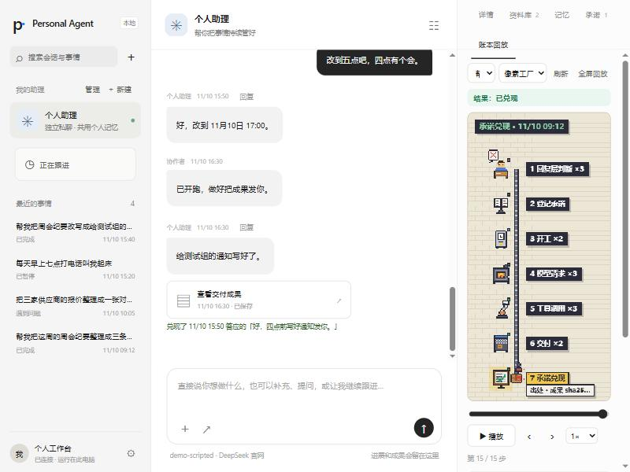
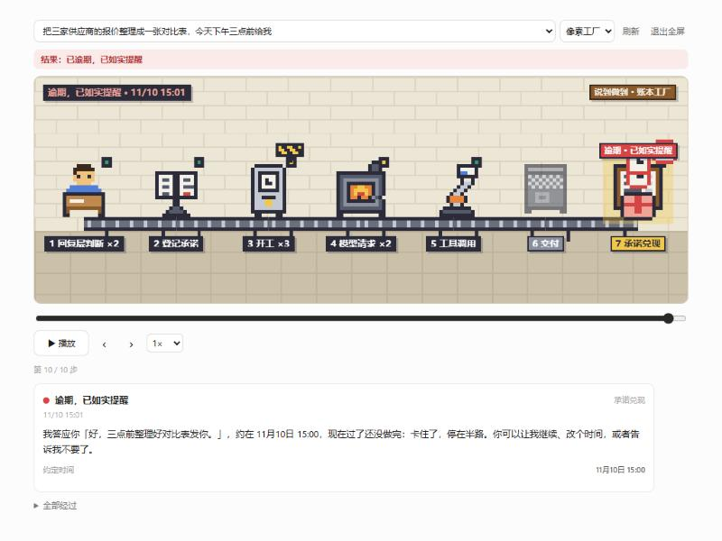
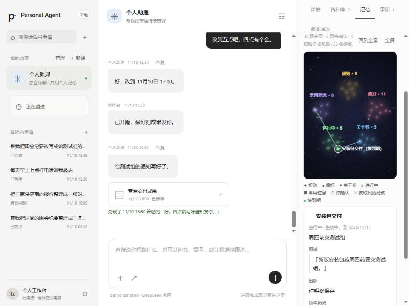
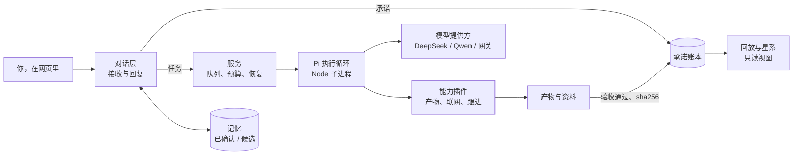

# Noyi

**说到做到的个人 AI 助理。** 每句「我去做」都登记成承诺，每份成果都附真实出处，它对你的推断要你确认后才算数。

[English](README.md) · 简体中文

名字取「一诺」的倒序谐音。



## 为什么做

聊天助手很会说「好的，到时提醒你」，却拿不出做过的证据。Noyi 是一个学习项目，只围绕一个想法：**助理说过的话要算数**。

- 承诺是账本里的一行记录，不是一句话。它绑定到负责兑现它的任务或安排。
- 「做完了」要附证据：产物、它的 sha256，以及实际读过的资料。
- 做不到就直说，承诺记为「做不到」。过了时限，提醒你一次。
- 从对话里推断出的记忆只是「候选」，你确认后才生效。

## 核心特性

**承诺账本。** 回复里的每句承诺都会登记，并关联到负责的工作。说明了时限的承诺，逾期时提醒一次；卡住超过一天的，也提醒一次。只有你能改约。回复里随口许诺却没登记的，会被拦下：要么登记，要么改口。

**带出处的兑现。** 任务交付前要过三项检查：产物完整、授权资料的读取覆盖、引用。兑现的承诺会链接到具体的产物版本和哈希。

**记忆候选区和每日整理单。** 记忆分五类：规则、偏好、关于我、进行中、常用信息。你明确说过的直接记下。助理推断的进候选区，附上原话作证据。每日整理单只提议合并和清理，你确认之前什么都不改。新记忆可以取代旧记忆，遇到矛盾时请你二选一。

**账本回放。** 选一件事，按时间回放它在账本里走过的七站：回复层判断、登记承诺、开工、模型请求、工具调用、交付、承诺兑现。逾期、做不到、改约、放下、被拦下的口头许诺都作为分支显示。可以播放、暂停、拖动、单步、变速和全屏。有简洁和像素工厂两种画风，全部由代码绘制。

**记忆星系。** 用星图只读地展示记忆。确认过的是亮星，待确认的是虚线暗星，被取代的是残骸，连向取代它的新记忆。七天内到期的「进行中」会闪烁。点开一颗星，可以看它的原话、出处和版本历史。

| 回放里的逾期承诺 | 记忆星系 |
|---|---|
|  |  |

截图都来自脚本生成的演示库（`scripts/demo-replay.py`），不是自用数据。

## 安装与快速开始

需要 Python 3.11+、Node.js 22.19+。下面的安装脚本面向 Windows，本项目只在 Windows 上测试过。其他系统请按手动步骤安装。

```powershell
git clone https://github.com/BaoBao1996121/noyi.git
cd noyi
.\Install.cmd
.\noyi.cmd start
```

`noyi start` 会打开 `http://127.0.0.1:8765`。后台服务用 `noyi stop`、`noyi restart`、`noyi status` 管理。数据保存在仓库目录下的 `.pa/personal`，该目录不进 Git。

手动安装（任意系统，Windows 以外未测试）：

```bash
python -m venv .venv
.venv/bin/python -m pip install -r requirements-lock.txt
.venv/bin/python -m pip install --no-deps -e .
npm ci --prefix ./src/personal_agent/pi_bridge --ignore-scripts
.venv/bin/python -m personal_agent --data .pa/personal web --port 8765
```

### 不用密钥先看演示

演示库由真实流水线配合脚本化模型生成，不调用任何模型 API。

```powershell
.\.venv\Scripts\python.exe scripts\demo-replay.py build --data .pa\demo-replay
.\.venv\Scripts\python.exe scripts\demo-replay.py serve --data .pa\demo-replay
```

打开 `http://127.0.0.1:8790`，选一件事，再看「账本回放」页或「记忆」页。

## 模型配置

点左下角的设置，填写模型名、地址和 API Key。密钥只保存在本机数据目录，设置页不会回显。不想把密钥存进数据目录的话，可以放进环境变量，再用 `PA_API_KEY_ENV` 告诉 Noyi 变量名（默认是 `DASHSCOPE_API_KEY`）。

| 提供方 | 地址 | 模型 | 密钥变量示例 |
|---|---|---|---|
| DeepSeek 官网 | `https://api.deepseek.com` | `deepseek-flash`（能看图） | `DEEPSEEK_API_KEY` |
| Qwen 官网 | `https://maas.qianwenaiapi.com/compatible-mode/v1` | `qwen3.7-plus` | `DASHSCOPE_API_KEY` |
| 本机网关 | `http://127.0.0.1:<端口>/v1`（只接受本机回环） | 网关上的模型 ID | `PA_GATEWAY_KEY` |

只有登记过的官方 HTTPS 主机和本机回环网关会拿到密钥。未知主机在联网前就被拒绝。在设置里第一次保存之前，模型由 `PA_MODEL`、`PA_BASE_URL`、`PA_API_KEY_ENV` 决定；保存之后以设置为准。详见 [`.env.example`](.env.example)、[`pa.example.toml`](pa.example.toml) 和 [模型配置](docs/model-configuration.md)。程序不会自动加载 `.env`。

联网搜索是可选的。模型用 DeepSeek 官网时，搜索和读网页共用同一把密钥。其他情况下，在 `[web]` 节单独配置搜索密钥。

## 架构简图



- **Python** 负责所有必须正确的部分：任务、账本、记忆、预算、授权和崩溃后的恢复。整体是一个 asyncio 服务加 SQLite。
- **[Pi agent core](https://github.com/earendil-works/pi)**（固定 1.5.0）在受管的 Node 子进程里跑工具循环。模型调用和工具由宿主掌握。
- 工具都是能力插件，新增能力不用改核心。见 [模块接口](docs/module-interfaces.md)。

## 现状与路线

当前版本 **0.6.0**，作者在一台 Windows 电脑上日常自用。

已完成：
- 模型接入：DeepSeek 官网（含识图）、Qwen 官网、本机回环网关。
- 记忆第一期，含候选区和每日整理单。
- 承诺账本。
- 账本回放，含简洁和像素两种画风。
- 记忆星系。

未完成：
- 第三方渠道（如聊天软件）、邮箱和日历账号、通用电脑操作。
- Windows 以外系统的安装验证。
- 英文界面。

以后想做再说：家里电脑常驻、更多渠道、浏览器工具。详情见 [STATUS](STATUS.md) 和 [决策记录](docs/decisions.md)。

## 关于这个项目

Noyi 是一个**学习项目**，用来弄懂一个能长期运行的个人助理怎样管理状态、承诺、证据和记忆。它不是产品，不承诺支持。设计、计划和验收报告都放在 [`docs/`](docs/)，失败和没测到的地方也如实保留。

跑测试不需要密钥：`python -m pytest -q`、`npm test --prefix src/personal_agent/pi_bridge`。参见 [CONTRIBUTING](CONTRIBUTING.md) 和 [命令行说明](docs/cli.md)。

## 许可

[MIT](LICENSE)
