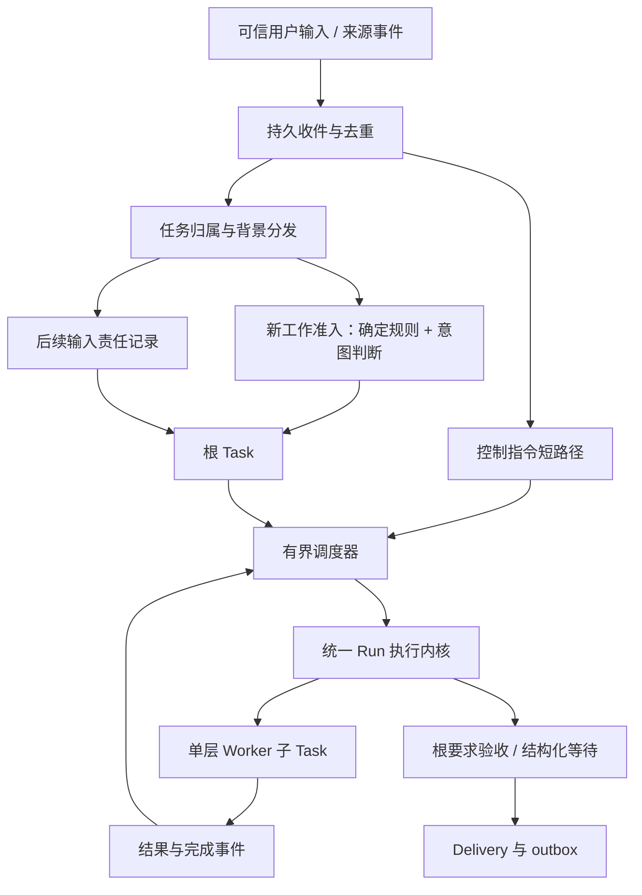

# DeepSeek 调研融入方案（已确认）

日期：2026-11-04。版本：DS-2026-11-04-approved-1。

用户已于 2026-11-04 确认采用本方案并恢复 M0。以下协议按各阶段实施；设计批准不等于实现完成。

本方案形成可审查的设计增量；本文的“应当”是待实施契约，不代表实现或测试通过。既有 D-A 至 D-E 继续有效，新增取舍见 [决策记录](decisions.md)。当前代码状态见 [STATUS](../STATUS.md)。

## 1. 资料覆盖和证据边界

已将远端 `main` 快进合入本地 `feat/m0-runtime`，资料提交为 `220df50`。两份新增文件均完整阅读：

- [完整调研报告](research/deepseek-super-agent-2026-11-04/DEEPSEEK_SUPER_AGENT_REPORT.md)，494 行。
- [开发交接说明](research/deepseek-super-agent-2026-11-04/PERSONAL_AGENT_DEVELOPER_HANDOFF.md)，190 行。

本次另外核对了官方仓库固定版本 `8c32a9dc5d72c033816c6a8110b37f40cf94fba4`：

| 一手材料 | 本次覆盖 | 支持的判断 |
|---|---|---|
| [001-domain](https://github.com/deepseek-ai/dsh-superagent-prototype/blob/8c32a9dc5d72c033816c6a8110b37f40cf94fba4/docs/001-domain.md) | 全文 | Thread、工作实体与订阅各有职责，关联证据本身不承担路由 |
| [002-authorization](https://github.com/deepseek-ai/dsh-superagent-prototype/blob/8c32a9dc5d72c033816c6a8110b37f40cf94fba4/docs/002-authorization.md) | 全文 | own/context、follow-up 交回、准入判断、observe、版本检查 |
| [003-execution](https://github.com/deepseek-ai/dsh-superagent-prototype/blob/8c32a9dc5d72c033816c6a8110b37f40cf94fba4/docs/003-execution.md) | 全文 | 结构化人工等待、输入消费、执行和投递恢复、并发边界 |
| [intake.ts](https://github.com/deepseek-ai/dsh-superagent-prototype/blob/8c32a9dc5d72c033816c6a8110b37f40cf94fba4/src/core/intake.ts) | 全文 | 背景扇出与无 owner 输入的新工作评估分别处理 |
| [effects.ts](https://github.com/deepseek-ai/dsh-superagent-prototype/blob/8c32a9dc5d72c033816c6a8110b37f40cf94fba4/src/app/effects.ts) | 全文 | 意图先落库；更新代次保护队列，旧回执不能删除新内容 |
| [policy.ts](https://github.com/deepseek-ai/dsh-superagent-prototype/blob/8c32a9dc5d72c033816c6a8110b37f40cf94fba4/src/policy.ts) | 定向阅读 assessmentOutcome、policyVersion、gate 及相关定义 | 推断工作须有规则依据；observe 记录 would_accept；规则组合有版本 |

原始 ZIP、`acceptance_cases.json`（30 个场景）、来源索引、`VALIDATION.md` 和原始测试日志尚未进入本仓库。报告中的“上游两次 1196/1197 通过、同一飞书健康断言失败、单测隔离后通过、类型检查和构建通过”属于报告作者的结果，本次没有原日志复核，也没有重新运行上游测试。以下 DS 系列是本次自拟场景，不冒充缺失的 30 个场景。

上传材料中的“直接实施”等交接文字不构成开发授权；本轮先完成融合设计，得到用户确认后再开发。保留研究原文，冲突统一在本方案处理。

## 2. 融入结论

保留 Python、asyncio、SQLite WAL、单常驻服务、有界并发，以及一个统一的 Bot/Worker 执行内核。模型继续使用 Qwen 官方服务，选型记录见 [模型配置](model-configuration.md)。不迁移上游框架，也不引入一个强制接管全部对话的全局总管。

| 研究建议 | 本项目处理 | 与现有方案的关系 |
|---|---|---|
| 后续消息有 owner，背景订阅不代表接单 | 融入，优先明确引用；每条 follow-up 同时只有一个负责根 Task | 新增最小关系；Room、Task、Run 保留 |
| 输入被消费不等于责任已完成 | 融入，分别记录保存、进入模型请求、处理结论 | 修正原方案单一 adopted 标记不足 |
| gate / assessment / action permission 分开 | 融入；M0 使用现有明确任务范围，完整主动准入放 M4 | 增量扩展原权限和 operation 规则 |
| Attention 与人工控制可恢复 | 融入现有 wait / Approval / Delivery 设计 | 这些对象仍是待实现设计，不能视为已有能力 |
| 效果队列代次、稳定操作身份、外部未知结果对账 | 融入相应阶段的恢复验收 | 不承诺远端 exactly-once |
| 先同 Bot 多任务、M2 再 Worker | 按已定顺序重排：M1 仍以单层 Worker 完整闭环交付 | 研究基线早于 D-A，不能覆盖已确认决定 |
| 上游额外人工并发槽位 | 采用人工优先或上限内预留容量 | 总并发硬上限与 actor 唯一活动 Run 不变 |
| 完成后任意人工消息恢复原工作 | 做本项目适配，见第 5 节 | 完成任务的闲聊不重跑；暂停恢复遵守 D-D |

## 3. 同一服务内的职责

这是职责划分，不是新增服务或多套执行平台。M0 走明确提交的根 Task；M1 增加后续输入关系与 Worker；M4 才启用通用主动准入。

## 4. 后续输入：谁接、是否看过、是否做完

### 4.1 路由与权限

- 原生讨论以 `(source_id, account_id, native_thread_id)` 标识；Room 是会话和受众边界，Task 是工作身份，三者不可互换。事件以来源、账号、原生事件 ID 防重。
- 路由按明确 task 引用、reply-to/原消息关联、唯一有效 own 关系依次判断。歧义输入保留 unassigned，并在需要时问一个最小问题；语义相似只能提供线索。
- `ThreadSubscription` 可多对多。`own` 提供责任候选，`context` 仅供背景；每条 follow-up 的实际 owner 只能是一个根 Task。不能把“一个 Thread 只能有一个任务”写成约束。
- 一个输入同时含多个无法明确分配的请求时，M1 留作未归属并澄清，不直接扇出成重复执行。后续若支持拆分，必须保留原事件和子请求身份。
- 背景扇出与新工作准入分别记账。bot/CI 输入可同时提供背景、进入有独立授权依据的新工作评估；有效人工 follow-up 已有 owner 时抑制重复建单，直到 owner 交回。
- 指向 task/thread/artifact 的 ID 只用于定位。取内容时仍检查当前 actor 的受众与资源访问权限；Worker 不因接到引用自动获得全部 Room 历史。

### 4.2 最小持久关系

| 记录 | 最小信息 | 不变量 |
|---|---|---|
| ThreadSubscription | task、source/account/thread、own/context、active、audience_ref | 背景可读不产生工作或动作授权 |
| FollowupDisposition | event、owner_task、状态、责任代次、要求版本、处理依据、历史 | 只有一个当前 owner；已看过不能自动消除责任 |
| InputUsage | message/event、run、模型请求序号、内容版本/哈希、请求状态 | 能追到实际组装提交的输入；认领队列不是使用证据 |

`FollowupDisposition` 使用 unassigned → pending → in_progress → handled；不属于本任务时持久记录 handed_back 与理由，再进入 unassigned/重新分配。交回与解除 owner 在一个事务内完成；旧 owner 不能在交回后用旧责任代次提交 handled。历史不可被新分配覆盖。

handled 需要可检查的结果：要求落实的产物/验收引用，或“纯致谢，无需工作”等明确处置依据。入队、模型回话、Run 结束、events.consumed 都不自动满足这个条件。尚有未处理的责任项时，Task 不能悄悄成功；应继续、持久等待，或明确交回。

输入事实分三层：已持久保存；已进入某次模型请求；责任已处置。请求发送意图先保存，记录响应或发送结果；崩溃窗口无法确定提供方是否收到时记 unknown。即使请求成功，也只证明该内容出现在请求中，不声称模型已经理解。`adopted_by_run` 若保留，只作兼容摘要，不作最终完成证据；多次使用由 InputUsage 记录。

### 4.3 审查时缺口与本轮落实

融合审查时，`store.py` 草稿在 claim 阶段便写 adopted，缺少逐次模型请求的输入覆盖记录，运行结束直接消费 claimed 事件。本轮 M0 已修正：实际请求单独留存 model_requests/input_usage，只有收到模型响应才标 adopted；中断请求保持 unknown，结束仅消费已完成请求纳入的输入。对应协议与故障测试见 [M0 验收记录](validation/M0_REPORT.md)。

独立 follow-up 责任结论、own/context 路由及结构化人工等待仍留到 M1；当前产物机械验收不证明以上完整协议或通用内容正确性。

## 5. 恢复语义：先找对任务，再决定是否继续

| 当前任务与新输入 | 拟采用行为 |
|---|---|
| 运行中，明确补充本任务 | 入持久队列；真实要求改变才递增 requirement_revision；旧版本结果不覆盖新要求 |
| paused，可信用户发来属于该根 Task 的新消息 | 遵守 D-D：视为明确继续，paused → on；新消息和待处理结果共同进入下一轮，无需再按一次继续 |
| paused，另一项任务的消息或未归属消息 | 不恢复它；归属不明的输入先保存、澄清，不恢复整个 Room 的任务 |
| paused，旧消息重放、bot/CI、context 或旧回调 | 保存适用事实，保持暂停 |
| 已完成，致谢或旧事件 | 无需重做，不建立重复任务 |
| 已完成，授权范围内确有新的补充工作 | 创建一个关联的后续根 Task，引用 prior_task_id 与有效授权；保留原交付历史，不同时重新打开原任务 |
| 已取消 / forbidden | 普通消息和旧结果不能复活；有新的明确有效委托时建新根 Task，重新校验范围和预算 |

“已完成后建关联任务”是本次已确认的具体选择。D-D 针对暂停任务，仍保持“属于该任务的新消息即继续”，不加必须使用“继续”一词的限制；完成后的礼貌消息则适用单独规则。旧问题的迟到答案按 Attention 版本拒绝，不能冒充新的恢复指令。

## 6. 准入、授权和等待

### 6.1 三种权限各有检查点

1. 读取权限决定哪些来源、材料和背景可见。
2. 接单权限决定能否创建/续做一项工作：代码核对原生身份、成员关系、范围和授权版本；模型判断意图、重复性与方向是否明确。
3. 动作权限在工具执行前再次检查当前授权、资源、requirement_revision 与 execution_epoch。消息里写“已批准”不能通过这一关。

M0 只落实明确任务的授权来源、声明工具范围与动作边界，不先建设完整规则管理器。M4 的 `AdmissionDecision` 保存事件、policy_revision、authority_ref、决定、原因和 would_accept。慢速模型判断之后，在创建 Task 的事务内重新核对所依赖版本，过期决定不提交。下次执行还须重查当前权限。

`AdmissionPolicy` 专指新工作准入；原周期/条件调度 Policy 可在文档称为 `RoutinePolicy`。事件接入叫 `EventSourceAdapter`，材料描述叫 `KnowledgeSourceDescriptor`；此轮不批量改接口名称。

off/observe/auto 针对新推断工作。observe 可消耗评估预算，但不派生执行 Task 或业务副作用。已明确授权的周期/条件动作、已有 Task 的合法续接照原授权执行，不被全局 observe 静默降级。一般规则调整与明确撤权分开：撤权阻止新副作用；已发出的远端请求保留 unknown/对账状态，不能报告“已经撤回”。

### 6.2 Attention 复用已有概念

在 wait / Approval / Delivery 上保存 task_id、question_id、目标答复者、requirement_revision、kind、状态与 resolution。kind 分 information、authorization、review；普通补信息不自动变成授权审批，已有充分授权的工作不重复请求确认。

问题更新、解决或失效时，同事务取消尚未发送的旧问题 Delivery。已发出的消息无法保证撤回，答案仍须按 question_id、答复者、版本和当前状态验证。重复回答幂等，旧回答保留审计但不改变新要求。重启后已解决不重问；未解决进入持久 wait，不占模型推理槽位。

### 6.3 控制优先

暂停、取消、状态查询经可信的轻量路径受理并落库，不等待当前模型返回。控制命令携带任务/Run 目标与版本，执行器在可中断边界检查；“停止已受理”和“执行已停止”分别显示。模型或工具能否立即中止按真实能力记录。

人工输入优先排队，必要时在总上限内预留容量。不得增加超出绝对并发上限的特例，也不得让同一 actor 并行执行两个 Run。队列饱和时仍可查询状态并登记停止。

## 7. 恢复、资料与交付

- Task 成果验收、Run 终态、Delivery 发送结果分别保存。发送失败只重试投递，不能再次执行已经成功的业务。
- 效果意图与业务状态同事务提交，提交后才发送/执行。可更新的队列项有 generation；旧尝试只确认自己认领的代次，不能删除新版本。M0 的不可变本地产物/投递先验证自己的恢复路径，M2 引入可变 effect 或外部写入前再实现通用协议。
- 逻辑 operation_id 按持久业务意图分配，重试复用；provider tool_call_id 只标识一次模型输出。远端成功而本地失联时，按能力用幂等键、读回对账或 unknown，不能换 ID 盲重放。
- 材料卡片用于发现与引用；需要查证时读取原文。记录来源版本、实际范围、失败和图表覆盖。仅有摘要或下载成功不足以声称完整阅读。请求中按预算装入必要片段，未读材料明确列出。
- 验收至少核对要求版本、实际产物、证据和未完成项。文件存在、字数够、模型自报完成只能是部分证据；根 Task 负责人仍负责结果质量。
- 自由 Bot/Room 的账号绑定与权限在 M3 落实；持续 Goal 的退出条件、游标与回声防重在 M4 落实；来源保留、记忆纠正/删除和防重账本生命周期在相应存储启用时定义，M5 用持续使用复核。上游测试用 memory repository 不作为个人长期记忆方案。

## 8. 实施顺序与过关条件

| 切片 | 本轮融合后的范围 | 各阶段应完成的验证 |
|---|---|---|
| M0 收口 | 一个 Bot、Qwen 官方模型、实际只读/产物工具、持久输入与真实产物；补齐请求输入证据和恢复边界，统一模型配置 | 原 M0 协议与故障检查；一条真实模型任务的输入、工具、产物、根要求验收和投递证据；不能只看机械检查 |
| M1-A | 明确任务引用、最小 own/context/disposition、有版本的补充/交回，以及停止契约的控制入口 | 同一 Bot 两项任务交错输入不串单；控制可在执行繁忙时入库 |
| M1-B | 单层异步 Worker、等待/结果事件、有限合批、根任务验收、停止/取消/续接预算 | 原 B01–B15 全部覆盖；单 Bot/Worker 复用执行内核 |
| M1-C | Attention 的持久等待、答案版本、问题投递撤销；将后续输入/人工控制接通整个 Worker 闭环 | 本文 M1 场景，加一条真实 Qwen 的交错任务与 Worker 闭环 |
| M2 | 结束门禁、Nudge、进展/停滞、handoff/review、artifact base_version；有外部写入前补 operation 对账 | 不用 Nudge 掩盖丢消息或未解决责任；未知副作用不盲重试 |
| M3 | 自由长期 Bot、Room/Team、确定账号绑定及访问边界 | 直接私聊任意 Bot；引用和背景不越权 |
| M4 | 持续 Goal、周期/条件触发、完整 AdmissionPolicy 和规则级 observe→auto | 已有授权不被降级；过期准入不生效；游标、回声与重复事件验证 |
| M5 | 复盘、自用、健康检查与保留/删除复核 | 实际成果、人工接管、误触发、总费用、持续故障记录 |

M1-A/B/C 是同一里程碑内的可审查增量，不把 Worker 再推迟到 M2。M0 不承担完整多任务路由、主动规则引擎、外部平台接入或复杂界面。

## 9. 本次新增的验收规格

下列全部为 `specified_not_run`，没有测试实现或通过记录。原 B01–B15 仍有效；收到缺失的原 30 个场景后再对照去重，保留来源。协议测试使用真实账本/调度代码配可控模型和故障注入；真实模型和真实渠道另列结果。

| ID | 阶段 | 输入/故障 | 应验证的事实 |
|---|---|---|---|
| DS01 | M0 | claim 后、模型请求前崩溃 | 有 received/claim 事实，无虚假请求使用或 handled；恢复后保留输入 |
| DS02 | M0 | 请求中途崩溃，或产物写完但结果事务未提交 | 请求状态可为 unknown；未验收不成功；重启核对已存产物，不伪造完成 |
| DS03 | M0 | 交付写出后、确认前崩溃 | 同一 delivery_id 恢复为一份有效投递；成功业务不重做；不声称用户已读 |
| DS04 | M1 | 同 Bot 的 A/B 任务交错补充；语义相似但明确引用 A | 只由 A 负责，B 仅按权限得到背景；重复事件不重复处理 |
| DS05 | M1 | 两个 own 候选，或一条消息含无法分配的两项要求 | 留 unassigned；一次必要澄清；不任意恢复任务或重复派工 |
| DS06 | M1 | owner 发现超范围，handback 后崩溃/迟到旧处理回执 | 交回理由与责任历史仍在；只一个新 owner；旧代次不能标 handled |
| DS07 | M1 | 模型读过补充，却在没有落实、等待或交回时结束 | InputUsage 存在，但责任未解决，根 Task 不自动成功 |
| DS08 | M1 | A/B 均暂停；发 A 的新消息，再重放旧 B 消息 | A 按 D-D 恢复并带待处理结果；B 保持暂停；A 只一个活动 Run |
| DS09 | M1 | 完成后致谢、有效补充；取消后普通消息/旧结果 | 致谢零新工作；补充恰好一个关联 Task；取消事实不消失 |
| DS10 | M1 | 问题被新版本替换，旧投递未送；旧答案/重复答案；回答后重启 | 旧投递撤销，旧答案不改新要求；有效答案一次生效，不重复问 |
| DS11 | M1 | 并发占满且模型/工具阻塞时查询、停止、续发消息 | 控制先落盘；显示真实停止状态；绝对上限及 actor 唯一性保持 |
| DS12 | M2 外部写入前 | 同 operation 远端成功、本地失联；effect 执行时更新 generation | 对账/幂等或 unknown；不盲重复副作用；旧回执不删新版队列项 |
| DS13 | M3 | 跨 Room 用合法形式的 task/artifact ID 猜取内容，或伪造正文身份 | 存储和工具入口拒绝越权；不因引用格式或语义判断放行 |
| DS14 | M4 | bot/CI 已作为 context 扇出，同时命中有效主动规则 | 背景照常进入；独立准入按规则记录，context 分支不吞候选 |
| DS15 | M4 | observe 的新推断命中；同刻已有明确授权的周期工作到期 | 前者只有 would_accept、无业务执行；后者按原授权和预算执行 |
| DS16 | M4 / 引入外部副作用时 | 评估未返回时改规则/撤权；动作发出后才撤权 | 旧决定不建新 Task；未发动作被阻止；已发动作对账，不宣称撤回 |

## 10. 已确认的实施范围

确认采用这套融合方案后，先恢复 M0 收口和真实 Qwen 闭环验证，再按 M1-A/B/C 推进。新增取舍包括：follow-up 唯一负责根 Task、分层输入证据、按目标任务恢复、完成后新建关联任务、可恢复问题，以及后续阶段的准入/动作边界。本轮已收到确认，先执行 M0，后续阶段按各自过关条件推进。
