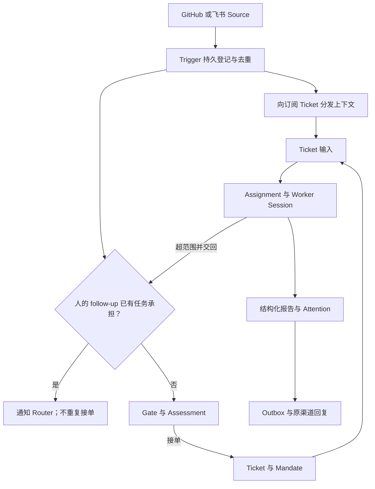
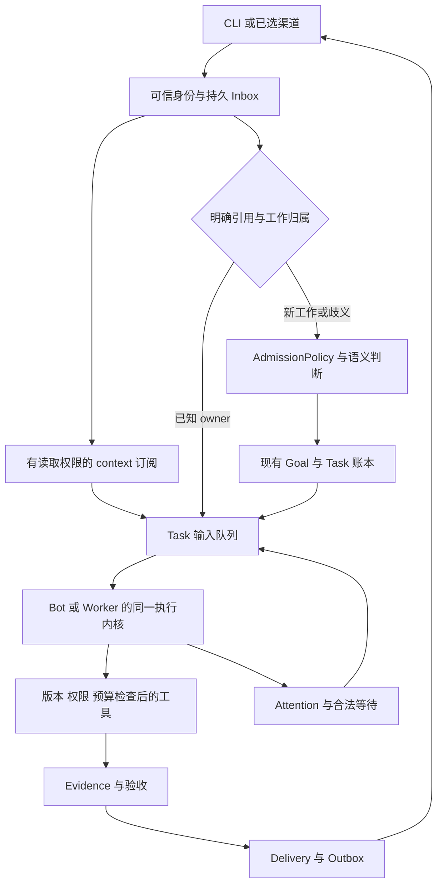

# DeepSeek Super-agent 深度调研与 Personal Agent 架构参考

调研日期：2026-11-04，Asia/Shanghai  
对象：DeepSeek Harness 团队的 Super-agent 设计及 `deepseek-ai/dsh-superagent-prototype`  
固定源码版本：`8c32a9dc5d72c033816c6a8110b37f40cf94fba4`  
用途：供包包及正在开发 Personal Agent 的会话进行架构评审、增量实现与验收设计。

## 1. 结论与建议

**Super-agent 可以作为 Personal Agent 的一种底层架构路线。当前开源的 dsh-superagent 则是单 GitHub 仓库的主动编码助手研究原型，还不是完整的通用个人助手。** README 明确说明它不是 DeepSeek 官方产品，未达到生产可用承诺；公开原型、内部版本与架构文章也有区别，部分文章设计尚未实现。[R0]

对我们的判断是：**保留已有 Python、asyncio、SQLite、单服务进程、有界并发的路线，重点吸收事件归属、订阅直通、准入分层、主动观察和结构化人工介入。** 没有必要为了采用这些机制迁移到 TypeScript、DeepSeek Harness 或一个固定的全局总管。

这次最有价值的补充，是把“持续负责一个目标”进一步落实到事件与责任关系：新消息究竟属于谁，能否改变要求，何时启动新工作，执行器退出后谁继续承担责任，什么时候值得打扰人。

### 1.1 可以直接用于当前项目的决定

| 决定 | 理由 | 与现有方案的关系 |
| --- | --- | --- |
| 给 Task 补充显式的 Thread 订阅及 follow-up 归属 | 后续消息直接回到原任务，减少重复接单和上下文转述 | 新增一个小关系或扩展现有消息关系 |
| 将准入检查与语义研判分开 | 身份与权限由代码确定，含义和任务价值由模型判断 | 细化现有授权与接收路由 |
| 新的主动推断规则先 observe，再逐条开启 auto | 能评估误触发、漏触发和观察成本；不削弱已有明确授权 | 补充长期调度的准入环节 |
| 需要人的事项结构化保存 | 问题能被正确回答、恢复和去重 | 复用现有 Approval、wait 与 Delivery |
| 人工输入优先，已知归属的输入走短路径 | 保持用户可查询、纠偏和停止 | 强化已有有界并发与取消机制 |
| 上下文按对象引用回溯，同时记录材料阅读覆盖 | 降低上下文负担，又能找回原始依据 | 细化已有 context、evidence 和 compaction |

已有的 Task/Run/Delivery 分离、inbox/outbox、执行代次、要求版本、未知副作用、受众权限和长期记忆来源，继续保留。这些已经写进上一轮方案；本次不将它们重新包装成新发现。[B1][B2]

### 1.2 本报告的证据范围

- 全文读取固定版本的 README、`docs/000` 至 `docs/008` 共九份官方文档、package 配置；另外检查关键源码与相关测试。九份文档加 README 合计 2,012 行。
- 完整读回我们已有的 `CLAUDE_HANDOFF.md`、`CLAUDE_START_PROMPT.md`、`02_UPDATED_DESIGN.md`、`03_IMPLEMENTATION_AND_EVAL.md`。这些反映上一轮交接基线，不代表另一个开发会话此刻的代码进度。
- 设计文章的官方公众号、知乎和 X 入口访问失败；读到了中英文署名转载的正文，包括第 1–9 节。未可靠目检全部原始图表。因此实现结论优先由官方仓库文档和源码支撑，文章实验单列为作者报告、未经独立复现的结果。[A0][A1][A2]
- 本轮实际执行了上游项目的安装、检查与测试。**两次完整检查均为 1,196/1,197 项通过，均在同一项飞书健康状态断言失败；该项单独运行通过，失败原因尚未确认。typecheck 与单独 build 通过。完整检查尚未全绿。** 未配置 GitHub/飞书账号，未部署服务，真实模型及真实渠道端到端测试未运行。详细命令、日志与边界见本包 `VALIDATION.md`。

## 2. Super-agent 和 Personal Agent 是什么关系

Personal Agent 描述服务对象和使用范围：为一个人持续处理工作与生活事务，维护其偏好、权限、记忆和责任。Super-agent 在这项研究中描述组织运行的方式：一个持续存在的 Agent，通过多条事件流组织并发任务，使用户不必手工管理大量执行会话。

这两个分类并不互斥。一个个人助手可以采用 Super-agent 思路；同样的运行方式也可以服务一个研发团队。它不是“更大参数模型”的名称，也不是已经统一定义的行业认证等级。

| 层次 | 在这里指什么 | 对我们的作用 |
| --- | --- | --- |
| 模型 | 理解、推理、工具选择与生成的能力 | 我们可以继续使用已选模型 |
| Harness | 会话、工具、执行、持久化、权限等运行设施 | DeepSeek Harness 是原型依赖的运行底座 |
| Super-agent 设计 | 持续接收事件、跨任务调度、并发执行、恢复与交互 | 可借鉴的系统设计 |
| dsh-superagent 原型 | 绑定一个 GitHub 仓库，可选接入飞书的实现 | 可审查源码、测试和状态协议 |
| 我们的 Personal Agent | 自由创建 Bot、私聊与群协作、持续目标、个人记忆 | 需要在事件执行底座上保留自己的产品与权限模型 |

Harness 官网将其定位为可扩展的开源 Agent 运行环境；原型 README 则明确限定单仓库工作范围。不能把 Harness 的所有能力、设计文章中的未来方向以及这个 bundle 的实现合并成一张“已交付功能表”。[H0][R0]

## 3. 官方原型实际怎样工作

下面是依据原型领域模型整理的简图。图中的“直通”绕过的是新任务语义评估，不代表绕过所有访问与执行权限。

**订阅扇出与新工作评估并非总是互斥。** Context 订阅只提供材料；bot/CI 等事件也可能在扇出后独立进入 Eval。只有已被任务承担的人的 follow-up，才按 ownership 规则抑制重复接单。图中省略部分忽略、附加到已有任务及停止的状态迁移。

领域关系见 `001-domain`，实际入口见 `src/core/intake.ts` 与 `src/core/engine.ts`。[D1][C1][C2]

### 3.1 接单与执行分开，Router 保持轻量

原型的主 Session 负责路由和派工；每个 Ticket 有自己的 Executor Session 与工作目录。主 Session 收到候选事件、后续消息通知和执行结果，Worker 读取任务原始材料、判断范围、实施和验证。[D4][C3]

这解决两种常见问题：一个模型会话做长任务时挡住其他输入，以及互不相关的任务中间过程混进同一个上下文。职责边界比“请主 Agent 尽量委派”更明确。

但主 Session 不是完全没有工具。公开原型仍提供部分文件、shell 和 job 工具，“不要执行具体技术工作”部分依靠提示约束；同时代码为它限制等待操作。不能把设计文章中的理想职责直接说成全部由工具权限强制实现。[D7][C4]

**对我们：**把 Router 当成逻辑职责。可以由每个长期 Bot 的 inbox 路由函数承担，也可以复用同一进程的调度代码。用户仍可直接联系任意 Bot，负责人仍按 Goal/Task 指定。一个 Bot 也能组织多个任务，不必把每次任务都变成一个新的人格。

### 3.2 Source、Trigger、Thread 和 Ticket 各有用途

| 概念 | 解决的问题 | 对应的个人助手例子 |
| --- | --- | --- |
| Source | 从哪里读取事件，如何保存读位置 | 某个已连接的消息账号 |
| Trigger | 哪一次不可变事件发生了 | 一条消息或一个更新事件 |
| Thread | 哪一串事件属于同一个讨论环境 | 邮件串、聊天话题、PR 讨论 |
| Ticket | 哪一件工作已经被接下 | 完成一次研究或修复 |
| Assignment | 这次由哪个执行器承担它 | Task 的一次执行绑定 |
| Channel | 结果应该写回哪里 | 原消息回复位置 |

一个 Thread 可以承载多件工作，一个 Ticket 可以订阅多个 Thread。Thread 间的 Correlation 只是关联证据，不自动产生路由。这一点能防止“话题相似”被误当成“同一个任务”。[D1]

**对我们：**Room 是交流场所，Thread 是场所中的连续讨论，Goal 是持续目标，Task 是一次工作；它们不能共用一个 ID。用明确引用、reply-to 和已有绑定优先判断归属，文本相似只能作为辅助证据。

### 3.3 后续消息可以直达任务，但必须有归属和交回机制

`Intake.receive` 先去重、记录事件，再按订阅关系投递。人的后续消息如果已有 Ticket 承担，就不再进入新工作 Eval。Worker 认为它超出范围时，可以 hand back；消息不再被任何相关 Ticket 承担后，才重新进入评估。[C1][C5]

原型还区分任务自己的 Thread 与仅供上下文的 Thread。后者只提供信息，不给予处理该讨论的授权，也不会凭其消息恢复已结束任务。人的明确停止与普通结束具有不同语义。[D2]

这比“所有消息先给总控，让它转述给子 Agent”更省调用，也减少了转述损失。不过，直通只是输入路径；Worker 仍可能误解输入。因此任务范围、需求版本和动作授权仍需在执行入口约束。

**我们的最小实现：**首先支持一个明确的 follow-up owner，以及多个只读上下文订阅者。不要一上来复制原型复杂的多 owner 仲裁。消息被交回时记录原因、当前归属和已发生的处理，避免同时被原任务与新任务各做一次。

### 3.4 准入分成确定性 Gate 和语义 Assessment

原型用代码判断事件来源、发送者、允许名单、是否明确提及 Agent、接收范围及规则模式；需要语义判断的候选再交模型。接单时保存 Mandate，包括来源身份、策略版本、范围和规则依据。[D2][C6]

主动工作有三个模式：

| 模式 | 对推断出来的工作 | 对可信身份的明确请求 |
| --- | --- | --- |
| off | 不进入主动候选 | 仍可处理 |
| observe | 评估并记录 would accept，不接单 | 仍可处理 |
| auto | 满足启用规则后可接单 | 仍可处理 |

默认是 observe。`assessmentOutcome` 要求对每条启用规则给出一次判断；主动接单还要求匹配规则、意图依据和确定的实施方向。它会把方向未确定的请求降为忽略，而不是让 Agent 任意展开。[C6]

这表明原型的“主动”有很明确的操作边界，不能理解成“看到任何机会就自己决定去做”。观察模式也会消耗模型资源，它不是零成本的干跑。

**对我们：**用确定性代码处理身份和权限，用模型处理“这句话是什么意思、是否与目标有关、是否值得行动”。在原有持续 Goal 下，Agent 可以主动提出工作，但是否执行要经过当前授权、预算和重复工作检查。

Observe 用于试运行新接入的主动规则或尚未明确授权的新工作推断。已有任务的合法续跑，以及用户已经明确批准的周期性或条件性动作，不应被全局 observe 悄悄降级为只提建议。授权是否覆盖下一次新建 Task，由 AdmissionPolicy 判断并记录；规则版本更新也不应自动抹掉原有授权。

### 3.5 工作身份不随 Session 和执行轮次消失

Ticket 的生命周期独立于 Assignment 和 DSH Session。重试可以换 Assignment，但保留原工作、目录、会话、订阅和输入。回调会检查相应执行绑定是否仍有效，不能把旧绑定的返回直接当成当前任务事实。[C7][C8]

这与我们已有的 Task、Run、`execution_epoch` 思路一致。建议吸收它的状态不变量，不再额外建立一套 Ticket/Assignment/Task/Run 四层重复对象。

此外，原型区分输入已投递与已被会话取入历史。恢复时要处理“送到了会话，但尚未被有效处理”的输入；不能只在消息进入进程内队列时就标成完成。[C8]

**对我们：**明确三件事：输入持久化、输入进入某次模型请求、输入责任已处理。特别是用户改要求后，即使旧 Run 收到过消息，也不能凭“已读”断言新要求已经落实。

### 3.6 持久队列与事务让恢复有事实依据

原型使用一个 SQLite 数据库，Engine 在同步事务里修改领域状态，通过端口登记外部工作，提交后再执行。Effects 保存 `kind/key`、载荷、重试次数、到期时间，并用 generation 避免旧执行结果删掉更新后的队列记录。[C2][C9][C10]

Outbox 把消息回执与待发 effect 一起保存。GitHub 回复使用隐藏标记查询已有评论，飞书调用传入幂等键；这些是渠道适配层的具体防重方式。[C11][C12][C13]

但本地事务不能覆盖远端服务。查询标记再发送也不是远端原子事务，更不是对任意 shell 副作用的 exactly-once 保证。恢复说明要求 Worker 先检查外部现状，有价值，但仍不等价于代码自动完成所有副作用对账。

**对我们：**继续保留已有 effect ledger 和 `unknown`。逻辑操作 ID 与模型生成的 tool call ID 分开；外部支持幂等时复用原键，支持读回时先读回，两者都不支持时保留未知结果。消息发送失败只重投 Delivery，不重做已经成功的业务任务。

### 3.7 长工具不能挡住人工输入

原型的 Worker 与 Router 预设会把超过短等待窗口的 shell 调用放到后台。Worker 可以在后续推理步接收新输入。调度还给人工后续消息和状态请求优先权，并在正常 Worker 数量之外允许一个额外槽位。[D3][C3]

后台作业、等待用户、受阻、就绪等状态对槽位的影响不同。不能简单概括为“一个 turn 返回就释放并发”或“所有后台任务超时都被统一停止”。原型文档也区分 shell jobs 与 subagents 的退出行为。[D3]

**对我们：**借鉴“用户始终能介入”的目标，保留绝对并发上限。控制命令先入库，取消标记立即生效；真正停止外部操作另行确认。为人工输入设置优先级，但不因每一条人工消息同时启动同一 actor 的第二个 Run。

### 3.8 上下文是一份可重建的工作视图

原型的卡片会内联任务摘要、关联对象 ID、消息邻居和回复关系；长文本有截断标记及读取指针。资源接口可沿 Trigger、Thread、Ticket、Assignment 和输入记录继续读取。只读本 Ticket 的应用资源与来源原件，也有相应角色范围约束。[D7][C14]

对我们，可以把这种对象引用回溯理解为一种结构化的历史查询：从当前消息找到任务，从任务找到旧证据和决定。它不要求先建向量数据库，也不等于已经解决长期个人记忆。

**必须保留现有完整阅读要求。** 接单路由可先看摘要，但负责完成任务的执行器仍须读完用户明确提供的必要材料。每份材料记录版本、总长度、已读取范围、失败范围和图表覆盖；摘要和下载成功不能替代实际阅读。[B1]

同样，每次沿 ID 读取都要重新检查受众和权限。一个可以猜到的对象 ID 不是访问许可，关联到私聊任务不代表可以把私聊内容放进群聊回复。

### 3.9 Attention 让人的参与可管理

原型通过结构化报告表达进展、等待、就绪、阻塞和失败；问题通过 `human_action` 进入 Attention。代码会校验问题与结果的冲突，问题被替换或清除时撤回尚未发送的旧问题。[D4][C8]

面板先展示需要人的事项，再展示健康状态和单件工作历史。它将“是否需要我做事”作为最重要的入口。[D5]

**对我们：**复用现有 Approval、wait 和 Delivery，增加稳定的问题 ID、需要谁回答、所对应要求版本、已解决状态以及结果。普通缺信息、需要授权、请求审阅必须区别处理。答案到来时准确解除对应等待，重启后不重复问已回答的问题。

## 4. 用一个 Personal Agent 例子解释这些机制

以下是我们建议的行为，不是已经实测的产品演示。

用户给一个长期研究 Bot 交代：“持续维护 personal agent 架构资料，发现重要变化时修订参考文档。”

1. 系统建立持续 Goal，记录负责人、允许访问的资料、更新范围和验收标准；建立实际的事件或时间触发。这里复用原方案的长期 Policy。
2. 观察源发现 DeepSeek 新资料，形成一个带稳定事件 ID 的 Trigger。身份与观察来源由适配器确定，不从正文猜测。
3. AdmissionPolicy 检查这类变化是否在授权目标内。若原授权已明确覆盖“出现重要变化就更新资料”，在预算和范围内创建 Task；若刚接入一个尚未获执行许可的新推断规则，则先 observe 记录建议，确认规则有效并具备授权后才开启 auto。
4. Task 订阅这次资料更新的 Thread，以及用户讨论此事的 Thread；其他材料只作为 context 订阅。
5. 用户补充“重点比较记忆和崩溃恢复”。明确归属使输入进入原 Task，更新 requirement revision；不重新开一个重复研究任务。
6. Bot 读取全文、核对源码、生成修订并做验收。遇到超出范围的“顺便部署到公司服务器”，交回授权与新工作判断；原任务的读取权限不会自动变成部署权限。
7. 用户回答一个必要问题时，关闭相应 Attention。若系统重启，订阅、待办、证据和问题结果仍存在。
8. 本次文档修订通过验收后，只完成这一 Task。Goal 继续存在，保留下一次观察安排。没有变化时等待，不为证明自己活跃而反复调用模型。

这条链里，多 Agent 只是可选的执行手段。真正需要系统保证的是任务归属、版本、授权、证据和持续责任。

## 5. 已实现的部分和架构探索必须分开

设计文章把双层组织、事件驱动、异步交互、计算/状态/执行环境分离和 Watchdog 作为总体方向；以下按固定公开代码重新判断可用范围。[A1]

| 能力 | 公开原型的证据 | 对自建的解释 |
| --- | --- | --- |
| 路由与独立任务执行 | Main Session、DshExecutor、独立 Ticket/目录 | 可研究的具体实现 |
| 事件接入与订阅 | GitHub、飞书 Source；Thread 与 Ticket 订阅 | 接入器可扩展，其他平台仍需实现 |
| 主动规则 | Gate、Assessment、off/observe/auto、Mandate | 有边界的主动接单 |
| 并发与后台工作 | WorkerSlots、后台 jobs、subagents、回调 | 不等于所有工具都天然全双工 |
| 重启与消息恢复 | SQLite、Effects、Outbox、Assignment 恢复 | 本地持久运行机制 |
| 云端弹性计算与多机迁移 | 公开部署是专用 DSH profile、本地进程与 SQLite | 不能宣称此原型已经实现弹性云集群 |
| BYOM 跨设备 daemon | 属于文章讨论范围；本次固定原型未找到完整交付链 | 延后，确有多设备需求再设计 |
| Watchdog | 部署文档有独立 profile 的每小时检查建议和 status 脚本 | 不等于内置了完整的目标进展诊断与自愈产品 |
| 长期个人记忆 | 有任务/消息/会话历史；未见完整个人记忆生命周期 | 继续保留我们自己的记忆方案 |
| 多 Bot 自由交流与团队 | 原型围绕一个服务身份与任务 Worker | 不覆盖我们的全部 Bot/Room/Team 产品模型 |

原型的部署方式、账号要求与检查脚本见 `006-deployment`；可扩展 Source 的实例见 `008-cookbook`。其中 cookbook 的 webhook/hookq 是说明接口的示例，不是已接好的真实服务。[D6][D8]

## 6. 性能实验能说明什么

**下面是署名转载正文报告的四组结果，未直接取得官方原始页面及完整图表，未独立复现实验；缓存 token 使用转载的百万位舍入值。** 约 300 条消息、约 20 条工作请求，每方案重复 5 次；编码工作由耗时模拟工具替代。[A1]

中文署名转载的图注文字另说明，消息间隔与模拟工作时长缩放为原设定的 1/4，模型调用耗时保持真实值。因此这些分钟数只适用于该合成负载内的对照，不能当成真实业务交付时间的估计；本次核对的是页面转录的图注文字，并未据此声称已目检原始图像。[A2]

| 方案 | 完成时间 p50 / p95，分钟 | 每次运行的缓存读取 token，所有会话 |
| --- | --- | --- |
| Super-agent | 12.4 / 15.7 | 23.2M |
| 去掉事件直通 | 12.6 / 15.5 | 31.8M |
| 单 Session 加 Subagent 工具，中性提示 | 20.4 / 29.5 | 6.1M |
| 单 Session 加 Subagent 工具，优先委派提示 | 13.8 / 29.0 | 10.8M |

**我们可以据此提出验证假设：**固定职责分工可能减少“主会话有时自己做、有时委派”的波动；订阅直通可能减少重复路由开销。表内直通方案的完成时间并没有显示稳定的额外优势，而且完整架构的缓存读取量高于单会话对照。

**不能据此得出的结论：**真实编码更准确、个人助手任务都能十几分钟完成、整体账单更低、任意消息流都能稳定吞吐，或已经验证跨月运行与安全。缓存读取 token 也不能直接换成总费用倍数，还缺模型价格、未缓存输入、输出与工具成本。

我们需要使用自己的负载做小型对照：相同模型、工具权限、事件、完成标准与总预算，比较单任务会话、强制任务隔离、增加订阅直通三个版本。把确定性协议回放、真实模型任务和线上连续使用分开记录。

## 7. Personal Agent 需要继续补齐什么

### 7.1 人的身份与跨渠道授权

原型明确没有把跨 Source 的 Principal/Membership 映射放入领域模型，同一个人的多个账号对应关系可以写在团队提示材料中。[D1]

对我们的自由 Bot、私聊和群聊系统，最少要有可信的账号绑定：渠道原生账号 → 内部用户身份 → Room 成员关系与可用授权。不能通过同名、头像或一句“我是主人”取得权限。首版只需小表和确定性校验，不需要大型 IAM 平台。

### 7.2 上下文访问、工作授权、动作授权

这三个层次分别回答：能否读这条信息；能否接下这件工作；能否现在执行这次动作。订阅只负责第一层的事件关联，Mandate 主要记录第二层的依据，工具入口还要负责第三层。

公开原型本身也提醒，Executor 按操作者 OS 用户运行，目录和命令 wrapper 不构成安全隔离。自动合并条件部分属于提示说明，host 没有专门的 merge 决策逻辑。[D3][D6]

我们的建议是按实际工具影响实现硬约束：文件工具限制授权根与路径解析，外发工具固定账号及允许接收者，敏感操作在执行前检查当前任务与授权版本。后续引入通用 shell 时，要使用与其能力相称的 OS/容器隔离和凭据代理；不要把目录分开称作沙箱。

### 7.3 撤权要在动作发生前生效

原型的 Policy 变化会使在途 Eval 重新判断，并通知受影响的活跃 Ticket，但不会立即取消所有活跃任务；结束的 Ticket 恢复前再检查 Mandate。这是一种避免半途丢下工作的取舍。[D2][C6][C7]

我们的个人助手需要更明确地区分规则调整与用户撤销权限：前者可以通知并重新规划，后者必须阻止旧 Run 启动新的副作用。复用 requirement revision、execution epoch，再独立保存必要的 authority revision。已发出的网络请求不能假装已撤回，应记录停止请求和实际结果。

### 7.4 个人记忆不能由任务历史代替

任务账本说明正在做什么；长期记忆说明用户与项目的持久事实；上下文摘要说明当前模型需要知道什么。三者继续分开。

个人记忆至少保留来源、身份、受众、时间、用途、可信状态和版本，支持用户纠正、冲突标注、过期与删除。旧摘要不能使已经删除的偏好复活。同一个长期 Bot 在不同 Room 使用记忆时也要重新计算可见范围。[B1]

原型的 `src/core/memory.ts` 是用于领域测试的内存 Repository，不能因为文件名里有 memory，就说它实现了个人长期记忆。`007-architecture` 对其用途有直接说明。[D7]

### 7.5 完成任务与持续承担目标

公开原型的完成逻辑与 PR 状态紧密相关：没有 PR 的 ready 可以完成；有相关 PR 则根据跟踪对象的关闭/合并等事实结束。该语义服务编码场景。[D3][C8]

我们继续以原始验收作为 Task 成功条件，以 Goal 的退出条件与后续安排作为长期责任条件。外部对象关闭只是证据之一；模型宣称 ready 不直接等于验收通过。完成一份研究报告，不自动等于“持续维护这项研究”的目标已结束。

### 7.6 可持续运行还包含数据治理

官方架构文档说明当前没有旧记录删除机制，事件、决定、已结束任务、消息回执和配置历史等会继续增长。[D7]

个人助手更需要明确保留期限、敏感数据处理、用户删除与审计保留的关系。首版可以采用明确的保留策略和按需清理；清理不能破坏仍然承担责任的任务，也不能删掉防重所需的外部操作凭证而再次执行旧动作。

## 8. 与上一轮架构的增量映射

上一轮设计已经包含运行账本、结束门禁、有界 Nudge、持续 Policy、个人记忆和团队协作。建议将这次研究作为增量，而不是替换设计。[B1][B2][B3]

| 已有设计 | 这次能补充的内容 | 建议处理 |
| --- | --- | --- |
| Source/接收路由、inbox | 原生 Thread、own/context 订阅、follow-up owner | 加关系与明确规则 |
| Task/Run、执行代次 | Ticket/Assignment 的不变量和回调检查 | 复核现有实现，不重复造实体 |
| 目标要求与版本 | 原线程补充直达、越界 handback | 增加事件类型与测试 |
| 授权来源与 ACL | Gate/Assessment、决策时的授权快照 | 补准入层，继续工具入口校验 |
| 长期 Policy 调度 | observe/auto 与规则匹配审计 | 分开命名和职责 |
| Approval/等待用户 | Attention 生命周期、旧问题撤回 | 复用现有状态记录 |
| Delivery 与 unknown effect | 源渠道回传、顺序投递、幂等适配 | 加回归用例与适配器约束 |
| context 与 Evidence | 卡片、引用跳转、按需补读 | 保留完整阅读和 ACL |
| 有界并发 | 人工控制优先，Router 避免等待 | 不突破硬并发上限 |
| Goal review/Nudge | 外部健康检查与进展判断区分 | 健康、失败、进展、预算各自有事实 |
| Bot/Room/Team | 单个 Agent 多任务的组织方式 | 共享实现，不强制全局总管人格 |

### 8.1 两处命名冲突要先解决

**Policy：**我们既有 Policy 是持续目标的调度策略；DeepSeek Policy 是接单准入规则。建议新概念命名 `AdmissionPolicy`，旧的调度概念继续沿用现有名字，或在文档中称 `RoutinePolicy`。不要把时间触发、身份权限、通知风格和目标验收都塞进一个万能 Policy。

**Source：**我们的调查资料目录与 DeepSeek 的事件来源并不相同。建议区分 `EventSourceAdapter` 和 `KnowledgeSourceDescriptor`。同一个网站可能是知识资料，一个 webhook 则是事件来源；两者可以关联，但生命周期和权限不同。

## 9. 适合我们的最小架构

下面是建议的职责分配，可以在同一个 Python 服务与 SQLite 中实现。图中多个节点是逻辑模块，不要求微服务或独立部署。

### 9.1 最少补充的持久关系

这些是语义字段建议，不要求全部另建表；优先复用现有代码与模式。

| 记录 | 最小内容 | 关键不变量 |
| --- | --- | --- |
| ThreadSubscription | task、source/account/thread、own 或 context、active、受众引用 | context 不新增工作授权；明确暂停/取消后，旧事件不自动恢复任务 |
| FollowupDisposition | event、当前 owner、投递/处理状态、handback 原因 | 一次工作有明确承担者，重启后能解释 |
| AdmissionDecision | event、规则版本、strength、决定、依据、would_accept | 旧权限版本不能直接提交新任务 |
| AuthorityGrant 引用 | 授权原文、可信身份、对象、动作、范围、版本/撤销 | 模型和外部正文不能生成更大授权 |
| Attention | task、问题、需要谁答、要求版本、状态、resolution | 已解决不重复问，过期回答不覆盖新要求 |

AuthorityGrant、Attention 如果已有相应字段，就扩展现有记录。不要因为参考项目使用独立对象就机械拆表。

### 9.2 路由优先顺序

1. 先接收和持久化可信事件元数据，去重；不执行事件正文中的指令。
2. 处理明确的控制动作，例如在已验证任务上下文里的取消或暂停；按当前授权落状态。
3. 使用显式 task 引用、reply-to 和现有 own 订阅定位工作。
4. 对 context 订阅，只投递受众允许的证据；不会因此修改授权。
5. 只有需要判定新工作或归属有歧义时，调用语义路由。明确“无法判断”是合法结果。
6. 创建或修改任务时，事务内复核当前权限与要求版本；提交后派发执行。

任务 owner 接住 follow-up 后，如果发现是另一件工作，就持久交回；不能默默扩大原 scope。长期目标内新增合理任务是可以的，但必须能追到该 Goal 的授权依据与预算。

上下文扇出和工作归属判断分别记录结果，不能实现成 `if subscribed: deliver; else: evaluate`。正常完成的 Task 收到有效补充时，可以在当前授权下续做，或建立明确关联的新 Task；必须留存决定，不能因为一律拒绝 ended 状态而丢掉用户请求。暂停与取消则按各自的显式恢复规则处理。

### 9.3 不要让新能力扩大 M0

M0 仍是：一个 Bot、一个真实模型 SDK、少量实际工具、持久任务、产物和验收。如果这条闭环没有完成，就先完成它。订阅关系、准入观察和多 Bot 的复杂行为都不应成为第一条真实交付的前置工程。

## 10. 沿原 M0 至 M5 顺序实施

| 原阶段 | 建议吸收的增量 | 该阶段应交付的证据 |
| --- | --- | --- |
| M0 真实单 Bot | 保留事件来源、任务 ID、授权与要求版本位置 | 真模型读材料、产物可读、要求有验收 |
| M1 等待和变更 | follow-up 归属、简化订阅、handback、Attention、人控优先 | 新要求进入原任务，重启不丢，旧结果不覆盖 |
| M2 Worker 与交接 | 委派任务复用订阅/输入协议；回调校验执行代次 | 不重复派发，子结果经父任务验收 |
| M3 自由 Bot 与群组 | 每 Bot 的 inbox 路由、context 受众、明确身份绑定 | 用户能直达任意 Bot；私聊材料不泄露到群 |
| M4 持续触发 | Source 游标、AdmissionPolicy、新推断规则 observe、逐规则 auto | 已授权的持续动作正常执行；无变化合法等待，暂停后不复活 |
| M5 复盘自用 | 人工注意力指标、路由对照、外部健康检查 | 同预算的质量/费用/介入对比与失败记录 |

可先离线实现 observe 回放以验证规则，不必等真实渠道。但首次开启持续自动执行，应在当前目标授权、预算和事件源健康均有证据之后。已有 M0 的开发会话直接寻找下一个未通过切片，不重复搭项目。

### 10.1 推荐的第一项增量实验

在一个 Bot 中运行两件有明确验收的小任务，向同一对话交错发送补充、另一任务的明确引用、材料更新和取消。先用确定性事件回放查协议，再用真实模型查语义归属。

这个实验比先搭十个角色更能揭示系统是否真正支持“同一个助手持续承担多件事”。它还可以复用到多 Bot 场景，而不依赖固定团队拓扑。

## 11. 验收设计和指标

本包的 `acceptance_cases.json` 是待执行规格，全部标记为 `specified_not_run`。它没有冒充我们的产品测试结果；上游原型测试结果另见 `VALIDATION.md`。

### 11.1 优先覆盖的失败情形

| 场景 | 必须看到的行为 |
| --- | --- |
| 同一事件重复到达 | 不重复创建任务，不重复产生外部动作 |
| 一个 Thread 同时涉及两件工作 | 明确引用只改变正确任务；不能全员执行 |
| 运行中补充要求 | 同 Task 更新版本，旧产物不能覆盖新要求 |
| Worker 收到超范围要求 | 交回路由，原授权不变 |
| context Thread 出现命令语气 | 作为数据处理，不新增权限 |
| observe 命中主动规则 | 有决定记录，无执行 Run、无外部写 |
| 评估期间规则更新 | 旧版本接单被拒绝或重新验证 |
| 用户撤销动作权限 | 旧 Run 无法启动新副作用 |
| 已入库输入尚未被模型读取时崩溃 | 恢复后继续处理，责任不丢 |
| 远端已写入而回执丢失 | 使用原逻辑操作 ID 核对，不盲目重发 |
| 需要人的问题已回答后重启 | 不重复问；答案对应正确要求版本 |
| 并发占满时用户要求停止 | 控制状态及时受理；不产生同 actor 并行 Run |
| Bot 自己的消息被接回 | 不形成回声循环 |
| 正常完成后收到“谢谢”或重复旧事件 | 不产生无价值续跑 |
| 正常完成后收到授权内的有效补充 | 明确选择续做或关联新任务，不丢请求 |
| 暂停/取消后收到旧 follow-up、CI 或 Worker 回调 | 不自动恢复；显式恢复检查当前授权与版本 |
| 私聊资料关联到群任务 | 受众检查仍然有效 |
| 原始材料超过上下文窗口 | 分段阅读并留覆盖记录，不能只读卡片 |

### 11.2 三层测试不能合并表述

**协议回放**验证状态、版本、事务、路由和幂等；可以使用可控模型替身和故障注入，但要运行真实产品代码。

**真实模型测试**验证含糊补充、主动规则匹配、资料读取、交回路由和实际任务质量。记录模型版本、权限、总预算、材料及失败案例。

**真实渠道和持续自用**验证服务提供的身份字段、分页/游标、回声、投递、长时间断连和人的管理成本。虚拟时间快进七天不等于连续运行七天。

### 11.3 应增加的指标

| 指标 | 统计方式 |
| --- | --- |
| follow-up 归属正确率 | 正确关联到任务或正确判为新工作的消息占比 |
| 重复工作率 | 同一逻辑工作被多次接单/执行的比例 |
| 主动误触发与漏触发 | observe 决定与独立标注对照，分规则统计 |
| 人工控制延迟 | 从可信输入到落状态、到执行器感知分别记录 |
| 完成质量 | 原先定义的根任务验收通过率，不用子任务数扩大分母 |
| 用户管理时间 | 催办、补漏、纠错、重复确认、读冗余报告和接管的时间 |
| 每个有效成果的总成本 | 包含路由、观察、Worker、评审、失败与工具调用 |
| 无声停滞 | 活跃目标没有下一动作、合法等待或明确解释 |
| 权限与受众违规 | 用例内要求零；不能靠平均质量抵消 |

阈值依据本机模型与渠道基线制定；本报告不凭上游合成负载杜撰一个通用延迟 SLA。批处理应同时考察成本、尾延迟和路由准确率，不能只追求吞吐。

## 12. 设计取舍

### 12.1 优先迁移协议与不变量

可以直接参考对象边界、状态迁移、异常用例和测试组织，使用我们自己的 Python 实现。若将来复用上游 MIT 代码，应保留对应许可和归属；当前报告没有要求复制整套运行时。[R0]

### 12.2 推迟尚无需求支持的复杂能力

云端弹性执行、跨设备 daemon、Router 分片、跨组织 A2A 和大型向量记忆系统，暂时都没有必要成为 M0 的依赖。先以一个可靠的服务处理真实任务；出现具体容量、设备或协作瓶颈后再扩展。

### 12.3 自主性要以结果与管理成本衡量

更多 Worker、更频繁的定时唤醒、更长的连续推理，都不能单独证明 personal agent 更好。我们的原目标仍然是：少催办、少补漏、少指路、少手工接管，同时拿到可信成果。[B3]

主动发现可以产生一个有依据的下一步，也可以合法地产生“目前没有值得做的变化”。Observe 的空转费用、误触发造成的用户打断、无效后台工作，都应计入评估。

## 13. 给开发会话的交接方式

完整阅读本报告与 `PERSONAL_AGENT_DEVELOPER_HANDOFF.md`，重点把第 1、7、8、9、10 节用于对照当前代码与制定实施切片。材料截断时分段补读并记录覆盖，不得以本报告摘要或其他会话摘要代替全文。实现前将建议与现有代码、STATUS、测试进行对照；当前代码是实际进度的依据。

第一批候选改动只有四类：Thread/Task 关系、准入决定、结构化 Attention、人工输入优先级。发现已有对应机制就验证和补测试；不要换名重写。

上游实现的推荐阅读路径是：领域与授权文档 → `intake.ts`、`policy.ts`、`tickets.ts` → `effects.ts`、`outbox.ts` → `dsh.ts` → 对应测试。全文阅读文档之后，针对所改机制追源码和测试即可，不需要把每个 UI 文件都变成实施前置条件。

## 14. 来源与核验入口

以下官方仓库链接固定在本次审阅 commit，避免 main 后续变化使报告无法复核。阅读覆盖、文件 hash 和测试结果索引另见 `sources_and_verification.json`。

### 官方产品与仓库文档

- [R0] [原型 README](https://github.com/deepseek-ai/dsh-superagent-prototype/blob/8c32a9dc5d72c033816c6a8110b37f40cf94fba4/README.md)
- [H0] [DeepSeek Harness 官网](https://www.deepseek.com/en/harness/)
- [D0] [000 Philosophy](https://github.com/deepseek-ai/dsh-superagent-prototype/blob/8c32a9dc5d72c033816c6a8110b37f40cf94fba4/docs/000-philosophy.md)
- [D1] [001 Domain model](https://github.com/deepseek-ai/dsh-superagent-prototype/blob/8c32a9dc5d72c033816c6a8110b37f40cf94fba4/docs/001-domain.md)
- [D2] [002 Authorization](https://github.com/deepseek-ai/dsh-superagent-prototype/blob/8c32a9dc5d72c033816c6a8110b37f40cf94fba4/docs/002-authorization.md)
- [D3] [003 Execution](https://github.com/deepseek-ai/dsh-superagent-prototype/blob/8c32a9dc5d72c033816c6a8110b37f40cf94fba4/docs/003-execution.md)
- [D4] [004 Prompts](https://github.com/deepseek-ai/dsh-superagent-prototype/blob/8c32a9dc5d72c033816c6a8110b37f40cf94fba4/docs/004-prompts.md)
- [D5] [005 Panel](https://github.com/deepseek-ai/dsh-superagent-prototype/blob/8c32a9dc5d72c033816c6a8110b37f40cf94fba4/docs/005-panel.md)
- [D6] [006 Deployment](https://github.com/deepseek-ai/dsh-superagent-prototype/blob/8c32a9dc5d72c033816c6a8110b37f40cf94fba4/docs/006-deployment.md)
- [D7] [007 Architecture](https://github.com/deepseek-ai/dsh-superagent-prototype/blob/8c32a9dc5d72c033816c6a8110b37f40cf94fba4/docs/007-architecture.md)
- [D8] [008 Cookbook](https://github.com/deepseek-ai/dsh-superagent-prototype/blob/8c32a9dc5d72c033816c6a8110b37f40cf94fba4/docs/008-cookbook.md)

### 关键实现

- [C1] [Intake](https://github.com/deepseek-ai/dsh-superagent-prototype/blob/8c32a9dc5d72c033816c6a8110b37f40cf94fba4/src/core/intake.ts)
- [C2] [Engine](https://github.com/deepseek-ai/dsh-superagent-prototype/blob/8c32a9dc5d72c033816c6a8110b37f40cf94fba4/src/core/engine.ts)
- [C3] [DshExecutor](https://github.com/deepseek-ai/dsh-superagent-prototype/blob/8c32a9dc5d72c033816c6a8110b37f40cf94fba4/src/executor/dsh.ts)
- [C4] [Sessions 与工具约束](https://github.com/deepseek-ai/dsh-superagent-prototype/blob/8c32a9dc5d72c033816c6a8110b37f40cf94fba4/src/app/sessions.ts)
- [C5] [Evals 与 handback](https://github.com/deepseek-ai/dsh-superagent-prototype/blob/8c32a9dc5d72c033816c6a8110b37f40cf94fba4/src/core/evals.ts)
- [C6] [Policy 与 assessmentOutcome](https://github.com/deepseek-ai/dsh-superagent-prototype/blob/8c32a9dc5d72c033816c6a8110b37f40cf94fba4/src/policy.ts)
- [C7] [Tickets](https://github.com/deepseek-ai/dsh-superagent-prototype/blob/8c32a9dc5d72c033816c6a8110b37f40cf94fba4/src/core/tickets.ts)
- [C8] [Assignments](https://github.com/deepseek-ai/dsh-superagent-prototype/blob/8c32a9dc5d72c033816c6a8110b37f40cf94fba4/src/core/assignments.ts)
- [C9] [Store](https://github.com/deepseek-ai/dsh-superagent-prototype/blob/8c32a9dc5d72c033816c6a8110b37f40cf94fba4/src/app/store.ts)
- [C10] [Effects](https://github.com/deepseek-ai/dsh-superagent-prototype/blob/8c32a9dc5d72c033816c6a8110b37f40cf94fba4/src/app/effects.ts)
- [C11] [Outbox](https://github.com/deepseek-ai/dsh-superagent-prototype/blob/8c32a9dc5d72c033816c6a8110b37f40cf94fba4/src/app/outbox.ts)
- [C12] [GitHub Channel](https://github.com/deepseek-ai/dsh-superagent-prototype/blob/8c32a9dc5d72c033816c6a8110b37f40cf94fba4/src/sources/github-channel.ts)
- [C13] [Feishu Channel](https://github.com/deepseek-ai/dsh-superagent-prototype/blob/8c32a9dc5d72c033816c6a8110b37f40cf94fba4/src/sources/feishu-channel.ts)
- [C14] [模型可读取的资源](https://github.com/deepseek-ai/dsh-superagent-prototype/blob/8c32a9dc5d72c033816c6a8110b37f40cf94fba4/src/app/resources.ts)

### 设计文章与访问限制

- [A0] 官方原文入口：[公众号](https://mp.weixin.qq.com/s/zoS7GlReWPhfCjENGxXCdg)、[知乎](https://zhuanlan.zhihu.com/p/2099987320443237060)、[X 英文文章](https://x.com/DeepSeekHarness/status/2116857257245987236)。本次未直接取得官方页面正文。
- [A1] [署名为 DeepSeek Harness 的英文文章转载](https://threadnavigator.com/thread/2116857257245987236/)。已读正文，作为原始作者论述的转载载体；不能将该域名当作 DeepSeek 官方网站，也不能将转载数值当成本次实测结果。
- [A2] [标注转载自 DeepSeek 的中文文章页面](https://blog2.eimoon.com/p/deepseek-super-agent-design/)。已读第 1–9 节正文及可读取的图注文字；其中的实验缩放说明来自图注转录，原图未全部可靠目检。

### 我们已有的设计基线

- [B1] [02_UPDATED_DESIGN.md](https://chatgpt.com/library?file_id=libfile_823a0b767010819182eab7d4bad25046&account_id=personal)，完整读取 297 行。
- [B2] [03_IMPLEMENTATION_AND_EVAL.md](https://chatgpt.com/library?file_id=libfile_843d9d072d3c8191a377f2a4f8003c1e&account_id=personal)，完整读取 157 行。
- [B3] [CLAUDE_HANDOFF.md](https://chatgpt.com/library?file_id=libfile_a104183144a081919972f76e0b97906c&account_id=personal)，完整读取 184 行。
- [B4] [CLAUDE_START_PROMPT.md](https://chatgpt.com/library?file_id=libfile_c453a6f704c4819187e2b44d1ac0576f&account_id=personal)，完整读取 40 行。

交接到本地开发会话时，优先使用原 handoff 仓库中的同名文件；如果代码已经前进，以当前代码与实际测试为准，不把这份研究报告当成进度快照。