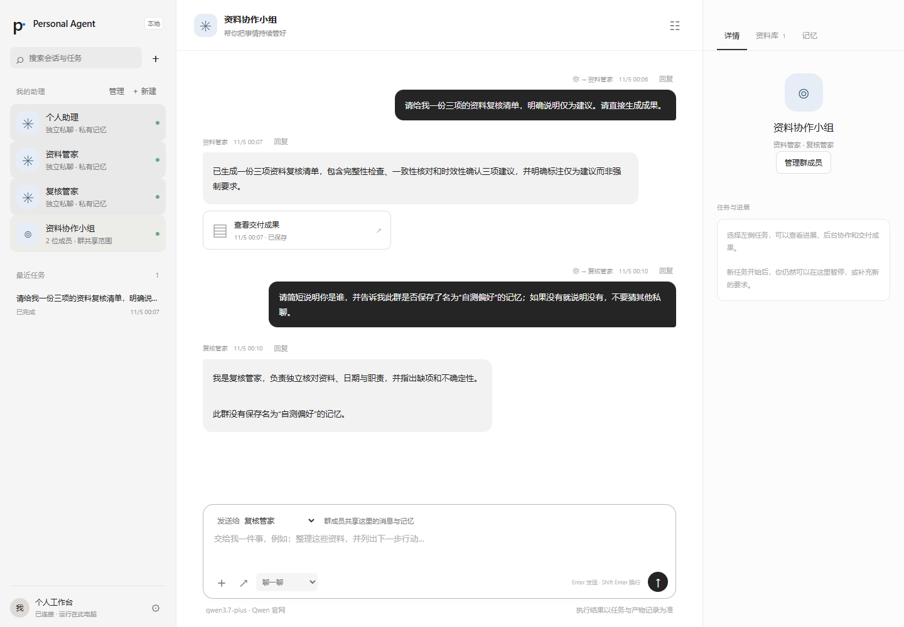
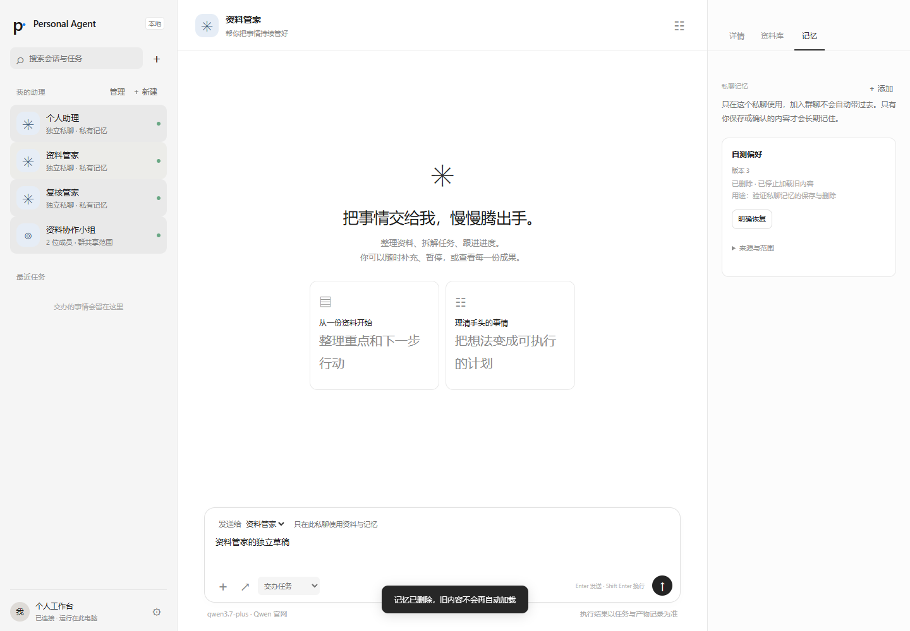

# M3：长期 Bot、群路由与显式记忆

验收日期：2026-11-05（北京时间）。M3 已完成本阶段验收；M4、M5 仍需继续实现，不代表整个长期目标完成。

## 实现

- 长期 Bot 的创建、角色修改、复制、归档和恢复；每个 Bot 独立私聊。群成员由本地用户明确选择，任何有效成员均可直接接任务或接收群内委派，没有固定负责人代理所有发言的限制。
- 明确任务、回复引用、选择成员、唯一 `@名称` 路由。歧义输入持久保留后分配；普通背景和致谢不唤醒全体。输入回执与任务创建同事务，兼容旧版 WebUI 重试时隐含预算默认值变化。
- 临时 Worker 仍不进入长期 Bot 列表。持久成员协作也走既有任务、审核、预算和停止协议。成员退出/归档立即使旧 Run 失效，实际执行退出后才能显式接手；原要求、已耗预算与责任不重置。
- Team 模板仅保存角色组合，与具体 Room 分开。复制 Bot、实例化团队均不复制原私聊、记忆、凭据或活动策略。
- 显式记忆包含 owner、audience、来源、采集身份、用途、可信状态、版本与时间。模型建议需要用户确认，一次性要求不自动成为永久偏好。
- 记忆区分未加载、读取失败、不存在、已删除。修正使用版本检查；删除保留无内容的墓碑，旧缓存/旧建议不能复活。会话上下文和衍生摘要在修正/删除后重建；历史聊天和原产物仍供用户追溯，不承诺抹除已经交付的历史文件。
- `MemoryProvider` 是真实的可替换读取接口，权威账本选定集合、条目 ID 与版本；替代实现不能用返回标签扩大读取范围。执行器、模型、来源读取、投递接口继续保留。
- WebUI 已连接多 Bot、群成员、直接回复/接收对象、分配、记忆保存/纠正/删除/确认、复制、角色与模板管理；每个会话独立草稿，默认对话不展开机械工具日志。

## 自动验证

完整 Python 回归 184 项通过，实际 Node/Pi 桥接 12 项通过。M3 专门新增 16 个场景，覆盖 T13–15、T22、T36 与 DS13：

1. 明确 `@`、回复引用、歧义分配、原消息身份、重启和重复提交。
2. 群任务猜取私聊任务/来源/记忆 ID，在存储与工具入口被拒绝；两个 Bot 私聊互不加载对方资料。
3. 复制角色/团队不复制隐私状态；成员退出使忙碌中的真实 Pi 子进程取消，退出前不能接手。
4. 记忆修正/删除版本、旧 provider 返回、故障状态、用户明确恢复、建议确认和受众变化后旧建议失效。
5. 可替换记忆 provider 的有效实现与伪造 ID/版本返回；聊天双方历史和遗忘后的上下文边界。
6. 两个持久成员通过真实 Pi 循环协作，仍使用根任务总预算；嵌套事务中途故障完整回滚。

可控模型用于时序、协议和权限测试，不作为真实模型质量证据。远端身份系统和多用户服务器未接入；当前是同一台电脑、本地用户拥有的回环 WebUI。

## 真实 Qwen 验收

仍使用官网 `qwen3.7-plus`，完整证据见 [live-evidence.json](m3/live-evidence.json)、[汇总](m3/summary.json)。材料是明确构造的测试资料，不是用户的真实隐私。

| 场景 | 结果 |
|---|---|
| 资料管家私聊 | 按私有短清单偏好读取本私聊资料并交付 |
| 复核管家私聊 | 按私有“确定项/疑问”偏好交付；未虚构未指定负责人 |
| 群协作 | 资料管家委派给复核管家；复核管家提出持久问题；根任务合法等待 |
| 直接补充给复核管家 | 补充只修改子任务责任与版本，根要求版本不变；旧问题失效，补充落实后回交 |
| 根审核与最终清单 | 已实际读取子产物并明确接受，负责人、截止日期、自查/复核、草稿条件和周三检查均正确 |
| 受众与重启 | 每次实际请求检查合成私聊标记，群/另一私聊均未混入；重开后 0 新模型调用 |

全队共 **24 次模型调用**（群根任务累计 16 次，包含协作者），输入 **133,934 tokens**，输出 **3,778 tokens**；没有失败工具操作。没有供应商账单，不能据此给出确定人民币费用。四份产物逐句与原文核对通过，复核由 Codex 完成，不声称有额外独立人工评审。

主实验保留进程启动时的代码哈希。随后修正的聊天历史、提示时间与旧 UI 回执兼容单独经过协议/浏览器验证；导出时哈希单列，不把它冒充主实验启动版本。

## 浏览器实测

实际 Chromium 表单/按钮完成创建、角色复制及修改、群成员选择、记忆 v1 保存/v2 修改/v3 删除。复制后的记忆与对话为空，私聊草稿在切换群聊、刷新与重启后保留。群里未指定对象的任务先持久保留，双击分配后只有一项任务；真实 Qwen 交付三项建议清单。随后直接选择第二位 Bot 聊天，它确认群内没有私聊中的“自测偏好”；回到原私聊删除后，模型明确回答“已删除”。

浏览器本阶段另有 **6 次调用**、输入 **15,586** / 输出 **527 tokens**，与上面的主实验分开计数。第二轮私聊通过“回复”引用，把刚才的“已删除”改写为完整句子，实际续接双方历史。[UI 记录](m3/ui-evidence.json)保留两次测试工具操作错误：失效元素引用，以及首次使用旧版 CLI 代码语法导致选择未执行。没有把失败选择记成成功；实际任务由默认资料管家接手，后续第二成员选择成功。

## 边界与后续

记忆默认加载最近 32 条、最多约 14,000 字符，其余可按标题读取；每个会话当前最多 128 条。近期聊天上下文有长度限制，完整历史仍在本地账本。资料工具仍只读明确授权的文本与地址，未增加任意命令或对外发送权限。

M4 将接入持续 Goal、真实周期/资料变化触发及规则准入；M5 继续统一界面、自用调优、对照和安装备份交付。当前截图与测试不证明长期多日稳定性，也不意味着 DSH/Pi 扩展生态已经兼容。
